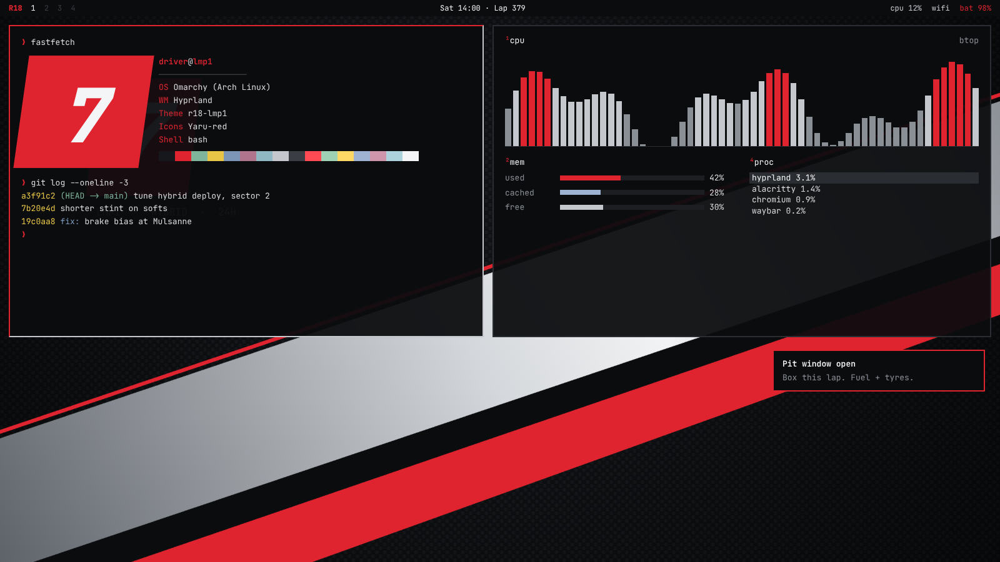

# R18 LMP1 — Omarchy theme

Carbon black, silver and race red, after the Le Mans prototype liveries.



## Install

```bash
omarchy-theme-install https://github.com/jbettcher-wg/R18-theme
```

Or from the menu: **Super + Alt + Space → Install → Theme**, and paste the repo URL.

### Manual install (keeps terminal configs + Neovim)

Installing from git drops `.lua` files and terminal configs for safety. To keep them:

```bash
git clone https://github.com/jbettcher-wg/R18-theme ~/.config/omarchy/themes/r18-lmp1
omarchy-theme-set r18-lmp1
```

## What's included

| App | File |
| --- | --- |
| Palette (generates everything else on Omarchy 3.2+ / 4.x) | `colors.toml` |
| Alacritty / Ghostty / Kitty | `alacritty.toml`, `ghostty.conf`, `kitty.conf` |
| Hyprland borders (red → silver) | `hyprland.conf` |
| Waybar, Walker, Mako, SwayOSD, Hyprlock | `waybar.css`, `walker.css`, `mako.ini`, `swayosd.css`, `hyprlock.conf` |
| btop | `btop.theme` |
| Neovim | `neovim.lua` |
| Chromium | `chromium.theme` |
| Icons | `icons.theme` → Yaru-red (bundled with Omarchy) |
| Wallpapers | `backgrounds/` |

## Palette

| | | | | | | | |
|---|---|---|---|---|---|---|---|
| `#0b0c0e` bg | `#d9dbde` fg | `#e0242f` accent | `#c4c7cc` silver | `#7fb59a` green | `#e8c547` yellow | `#7c96b8` blue | `#8fb8c2` cyan |

Fan-made theme; not affiliated with or endorsed by Audi AG.
